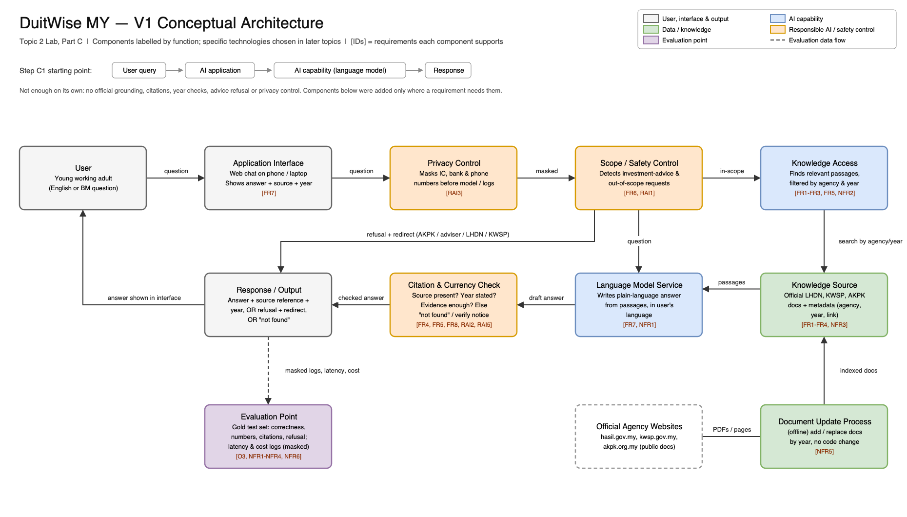

# Architecture Decisions & Traceability — DuitWise MY

Version: 1.0
Diagram: [`week2_architecture_v1.png`](week2_architecture_v1.png) (editable source: [`week2_architecture_v1.drawio`](week2_architecture_v1.drawio))
Links to: [`week2_requirements.md`](week2_requirements.md), [`week2_evaluation_criteria.md`](week2_evaluation_criteria.md)

> V1 is a conceptual architecture. Components are labelled by function; specific models, retrieval methods, frameworks and platforms will be chosen in later topics.

---

## Step C1 — Start with the Simplest Architecture

**Starting point:** User query → AI application → AI capability (language model) → Response

- **Main user interaction:** a young working adult types a question about tax reliefs, EPF or budgeting into a chat interface, in English or Bahasa Melayu.
- **AI capability needed:** a language model that understands the question and writes a plain-language answer.
- **Can this satisfy the requirements?** Only FR7 (plain language, matching language) and possibly NFR1 (latency). It cannot meet the rest: a model on its own has no access to the current official documents (FR1–FR3, NFR2, NFR3), cannot cite them (FR4, RAI2), does not know which year a rule belongs to (FR5, RAI5), has no reliable way to refuse financial advice (FR6, RAI1), sends whatever the user types to the model service (RAI3), and gives no way to measure quality (O3). The components below were added only to close these gaps.

---

## Step C2 — Architecture Needs from Requirements

| Requirement ID | What does the requirement need? | Architecture Response |
|---|---|---|
| FR1, FR2, FR3, NFR2 | Answers must come from official LHDN, KWSP and AKPK documents and be correct. | **Knowledge Source** (official documents) + **Knowledge Access** (finds relevant passages for each question) |
| NFR3 | Numbers (RM caps, percentages, ages) must exactly match the source; many sit in PDF tables. | Knowledge Source keeps tables and numbers intact with their document; answers are generated from retrieved passages, not memory |
| FR4, RAI2, FR8 | Every answer needs a verifiable source; say "not found" when evidence is missing. | Document metadata (agency, title, year, link) in the Knowledge Source + **Citation & Currency Check** on the output |
| FR5, RAI5 | Answers must state the year of assessment and flag unsupported years or superseded rules. | Year metadata used by Knowledge Access to filter passages + year check in the Citation & Currency Check |
| FR6, RAI1 | Investment/product advice and out-of-scope questions must be refused and redirected. | **Scope / Safety Control** before knowledge access, with a direct refusal-and-redirect path to the response |
| RAI3 | Personal identifiers must not reach the model service or logs. | **Privacy Control** that masks IC, bank and phone numbers immediately after the interface |
| FR7, RAI4 | Plain language, same language as the question, similar quality in English and BM. | **Language Model Service** instructed to answer in the user's language; documents in both languages where available |
| NFR5 | New year-of-assessment documents must be added without code changes. | **Document Update Process** (offline) that adds or replaces documents and their metadata |
| NFR1, NFR4, NFR6, O3 | Latency, cost, reliability and quality must be measured. | **Evaluation Point**: gold test set runs plus masked logs of latency, token cost and errors |

---

## Step C3 — V1 Conceptual Architecture

**Main flow:** User → Application Interface → Privacy Control → Scope / Safety Control → Knowledge Access ↔ Knowledge Source → Language Model Service → Citation & Currency Check → Response / Output → shown to the user.

**Refusal path:** Scope / Safety Control → Response / Output (refusal + redirect to AKPK free advisory, a licensed adviser, or LHDN/KWSP channels), without calling the knowledge or model components.

**Offline path:** Official agency websites → Document Update Process → Knowledge Source.

**Where Responsible AI controls apply:** Privacy Control (RAI3), Scope / Safety Control (RAI1), Citation & Currency Check (RAI2, RAI5).

**Where evaluation applies:** Evaluation Point, fed by masked logs from the response stage and by offline runs of the gold test set.

---

## Step C4 — Architecture Decision Record (ADR)

| Decision | Requirement / Constraint | Alternatives Considered | Selected Option | Trade-off Accepted |
|---|---|---|---|---|
| **ADR1 — Include knowledge access over official documents** | FR1–FR4, NFR2, NFR3: answers must be grounded in current official rules with exact numbers | (a) Base model only; (b) fixed FAQ lookup table; (c) dynamic knowledge access over official documents | (c) Generic knowledge-access component with a knowledge source of official documents | More system complexity and dependence on how well PDF tables are processed, but much better grounding, exact numbers and traceability |
| **ADR2 — Store year/agency metadata and check currency on output** | FR5, RAI5, NFR5; constraint: rules change every year of assessment | (a) Keep only the latest documents and ignore years; (b) let the model infer the year; (c) explicit year metadata + output year check | (c) Year metadata on every document, used for filtering and checked before answering | More preparation work per document and more "please verify / year not covered" replies, but users are not misled by outdated rules |
| **ADR3 — Explicit scope / safety control for financial advice** | FR6, RAI1: must refuse investment and product advice | (a) Instructions in the model prompt only; (b) explicit scope-control component before retrieval | (b) Explicit scope control with its own refusal-and-redirect path | Possible false refusals on borderline questions and a little extra processing, but more consistent and testable refusals (measured by refusal rate and false refusal rate) |
| **ADR4 — Mask personal data before the model service and logs** | RAI3; constraint: PDPA 2010 | (a) Rely on a "do not share personal data" warning; (b) do not keep any logs; (c) privacy-control component that masks identifiers, plus the warning | (c) Masking component + warning | Extra processing and some harmless numbers may be masked by mistake; free-text details (e.g. salary described in words) may still slip through. Logs are kept, but masked, so evaluation is still possible |
| **ADR5 — Information only: no tax calculator or account access in V1** | Out-of-scope list; RAI1; one-semester constraint | (a) Add a tax-payable calculator tool; (b) connect to e-Filing / i-Akaun; (c) explain rules only and link to official tools | (c) Information only, with links to LHDN e-Filing and KWSP i-Akaun for actions | Less convenient for users who want a final number, but avoids high-risk calculations, account security issues and scope creep; keeps V1 simple |

---

## Initial Requirements Traceability Matrix

| Objective | Requirement | Evaluation Criterion | Architecture Element | Later Evidence |
|---|---|---|---|---|
| O1 | FR1–FR3, NFR2 | Answer correctness (≥ 85%) | Knowledge Source + Knowledge Access + Language Model Service | Gold-set run of 60 questions scored with the correctness rubric |
| O1 | FR4, RAI2 | Source citation and support (100% presence; ≥ 95% match) | Knowledge Source metadata + Citation & Currency Check | Citation audit of every gold-set answer against the cited passage |
| O1 | FR7, RAI4 | Clarity and language parity (≥ 4.0/5; ≤ 10 pp gap) | Language Model Service | Clarity rubric scores and English vs BM correct-rate comparison on 30 parallel questions |
| O2 | FR6, RAI1 | Advice refusal without over-blocking (≥ 95% refusal; ≤ 10% false refusal) | Scope / Safety Control + refusal-and-redirect path | Scope test set results (≥ 30 advice-seeking + ≥ 30 in-scope queries) |
| O2 | RAI3 | Personal data protection (0 unmasked identifiers) | Privacy Control | Inspection of model payloads and logs from ≥ 20 synthetic-PII conversations |
| O2 | FR5, RAI5 | Outdated-information flagging (≥ 95%) | Year metadata + Citation & Currency Check | Results on ≥ 15 unsupported-year / superseded-rule questions |
| O3 | NFR3 | Numerical accuracy (≥ 95% exact match) | Knowledge Source (tables kept intact) + Citation & Currency Check | Number-by-number comparison of gold-set answers with source values |
| O3 | NFR1, NFR4 | Response latency and cost (p90 < 5 s; < US$1.00 / 100 queries) | Evaluation Point (latency and cost logging) | Benchmark run over the evaluation workload |

---

## Final Review Checklist

- **Does each major component support a requirement or evaluation need?** Yes — every component in the diagram is tagged with the requirement IDs it supports.
- **Is any important data source, safety control or evaluation point missing?** No for V1. A user feedback channel (thumbs up/down) is not included yet, because no current requirement needs it; it can be added in a later version for monitoring.
- **Have I added any technology or component that is not yet justified?** No specific technologies are named. The Document Update Process is justified by NFR5 and the yearly rule changes.
- **Is there a simpler architecture that could still satisfy the requirements?** The Privacy Control and Scope / Safety Control could be merged into one input-check component, but they are kept separate because they are tested separately (RAI3 vs RAI1) and fail in different ways. The base-model-only design was rejected (see Step C1).

---

## Reflection — Part C

**Which architecture decision involved the most important trade-off? Which requirement drove the decision, and what trade-off did you accept?**

**ADR3 (explicit scope / safety control)** involved the most important trade-off. It was driven by **FR6 and RAI1**: DuitWise MY must not give investment or product advice, because a user who follows a "recommendation" to withdraw EPF savings or buy a product could lose money that is hard to recover. Relying only on prompt instructions would be simpler, but it is hard to test and can be bypassed by rewording. An explicit control makes refusals more consistent and measurable. The trade-off I accepted is **false refusals**: borderline questions like "Is it better to keep my Akaun Fleksibel savings?" may be refused even when the user mostly wants information, which makes the assistant less helpful. To keep this trade-off visible, RAI1 has two thresholds (≥ 95% refusal of real advice requests and ≤ 10% false refusals), and refusals always include a redirect, such as AKPK's free advisory service, so the user still has somewhere useful to go.
